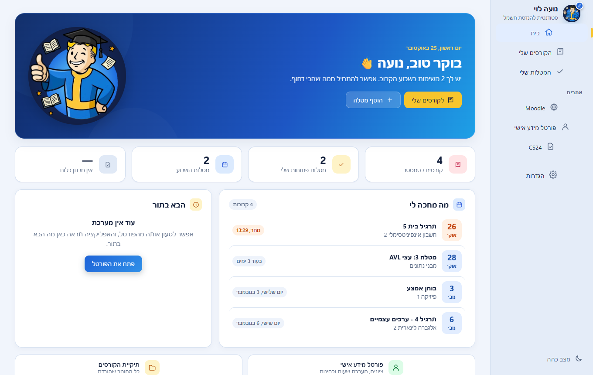
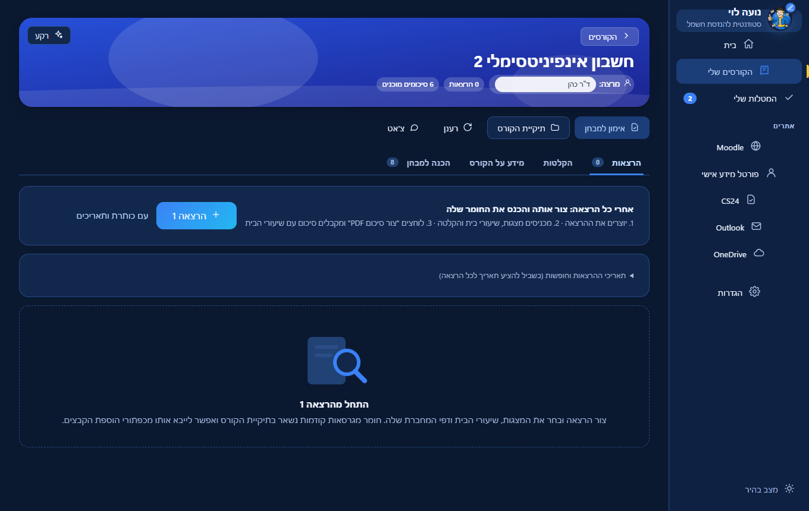
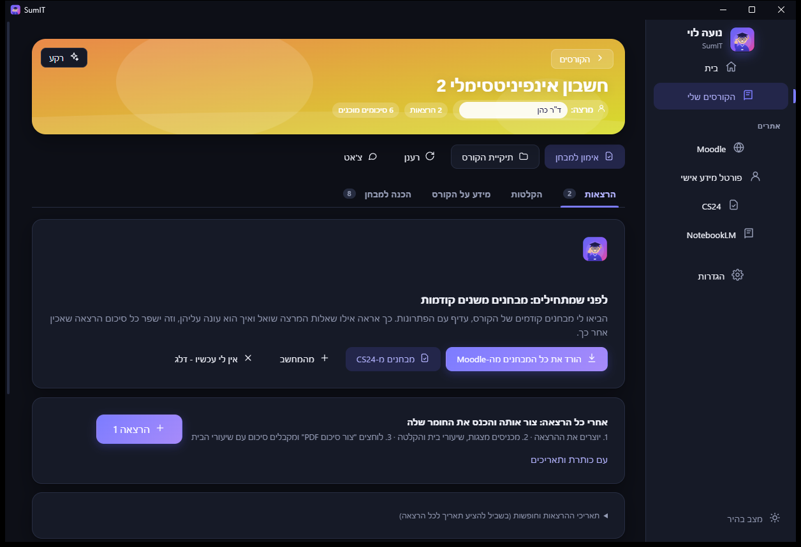
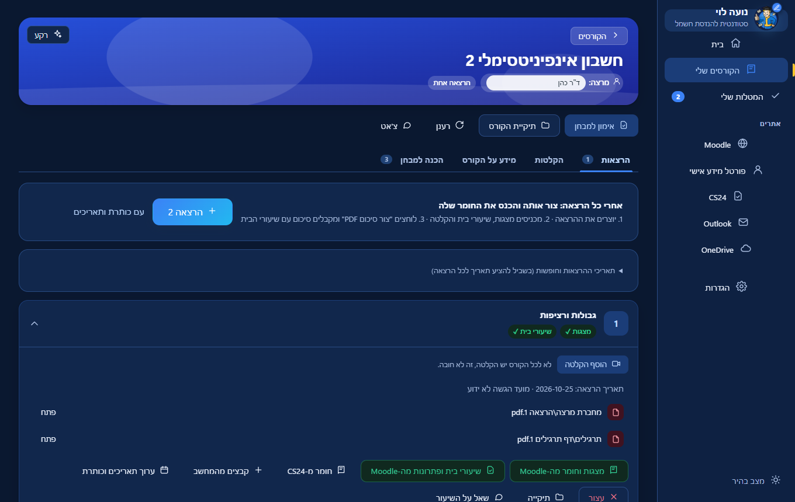
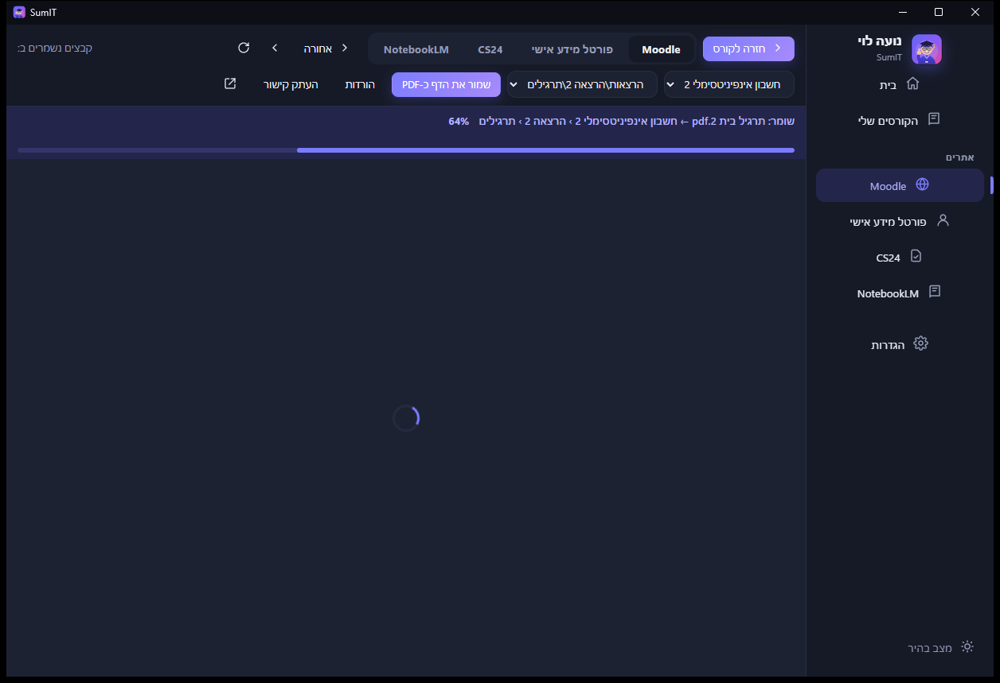
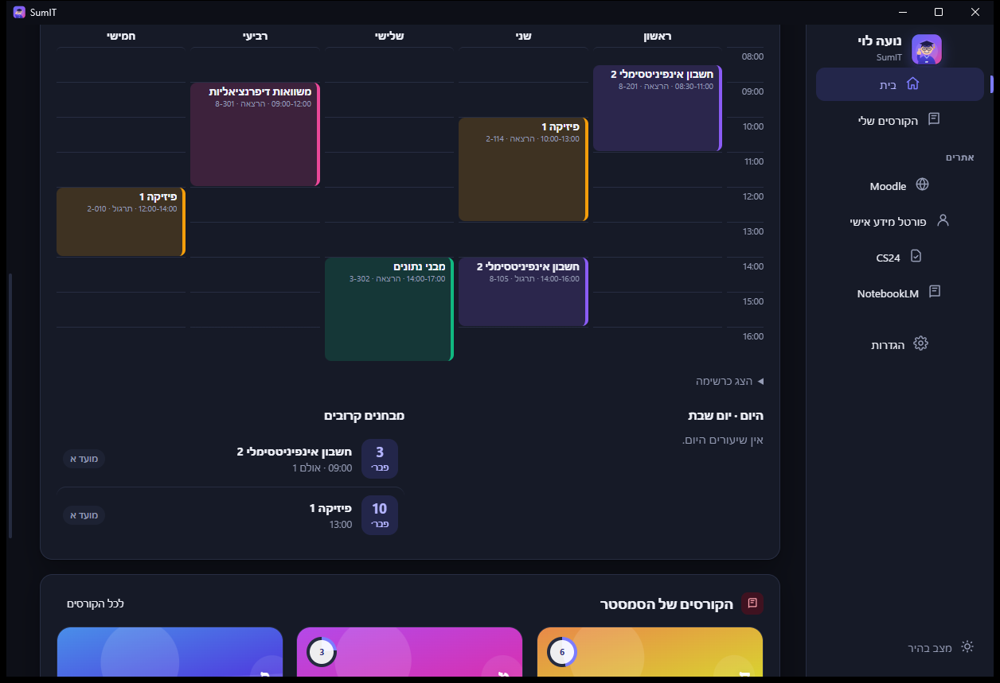
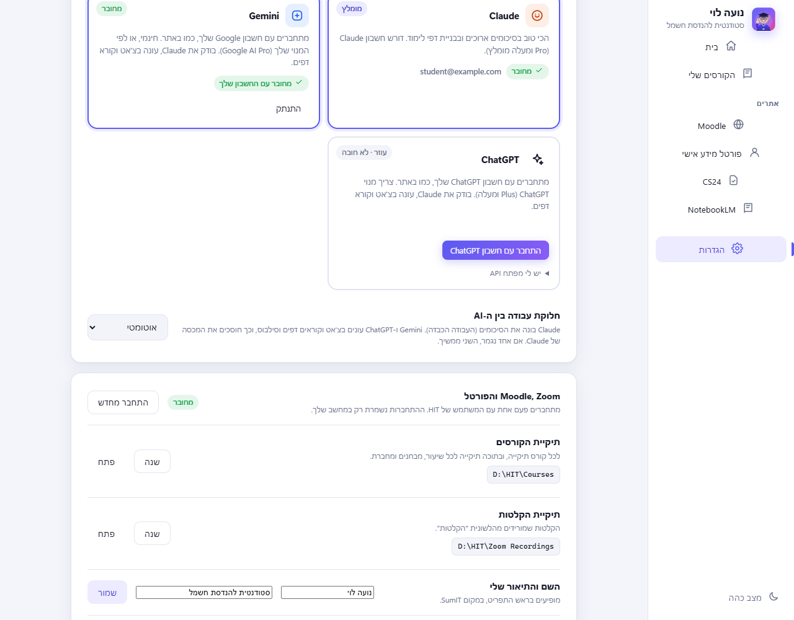

<div dir="rtl" align="center">


# SumIT

**אחרי כל הרצאה: מכניסים את החומר, ומקבלים סיכום מלא עם שיעורי הבית.**

אפליקציה ל-Windows לסטודנטים ב-HIT. היא מחברת את Moodle, Zoom ו-CS24, ובונה לכל הרצאה סיכום מסודר שמסביר גם איך לפתור את שיעורי הבית, לפי איך שהמרצה שלך חושב.



</div>

<div dir="rtl">

## איך זה עובד

1. **יוצרים את ההרצאה** - כפתור אחד, והיא מקבלת תיקייה משלה ותאריך (לפי המערכת שלך והחגים).
2. **מכניסים את החומר** - מצגות ושיעורי בית מ-Moodle, חומר מ-CS24, קבצים מהמחשב, קישור להקלטת Zoom. מחברת (Notability או אחרת) שומרים כ-PDF בתיקייה של ההרצאה והאפליקציה מזהה אותה לבד.
3. **לוחצים "צור סיכום"** - ומקבלים סיכום של כל ההרצאה, ואחריו שיעורי הבית: לכל שאלה לאיזה חלק בסיכום היא קשורה, איך מתחילים אותה, ואיך המרצה מצפה שיענו. הסיכום נפתח בתוך האפליקציה, ויש גם קובץ PDF.

כל הרצאה נבנית על הקודמות: הסיכום של הרצאה 3 מכיר את החומר של 1 ו-2.

<div align="center">

</div>

### לפני הרצאה 1: מבחנים משנים קודמות

האפליקציה מורידה בלחיצה אחת את כל המבחנים והפתרונות מה-Moodle של הקורס (או מ-CS24, או מהמחשב). כך היא רואה אילו שאלות המרצה שואל ואיך הוא עונה עליהן, וזה משפר כל סיכום שנבנה אחר כך. בלשונית "מידע על הקורס" לחיצה אחת מורידה את הסילבוס וקוראת אותו.

<div align="center">

</div>

### בזמן שהסיכום נבנה

סרגל עם אחוזים וזמן משוער (לפי כמה זמן לקחו הסיכומים הקודמים), וההתקדמות נשמרת גם אם עוברים למסך אחר וחוזרים. סיכום לוקח כמה דקות. עדיף לחכות ולקבל משהו טוב.

<div align="center">

</div>

### בחירת קבצים מהאתרים

Moodle, הפורטל ו-CS24 נפתחים בתוך האפליקציה. מעל האתר רואים לאן כל קובץ נשמר (הקורס, ההרצאה, מצגות או שיעורי בית), יש אחוזי הורדה, כפתור "שמור את הדף כ-PDF", וכפתורי חזרה לקורס ולדף הקודם. כשנכנסים להקלטת Zoom האפליקציה מציעה להוריד אותה להרצאה.

<div align="center">

</div>

### המערכת שלך

טבלה שבועית עם כל השעות, והמבחנים הקרובים. בפורטל או בלוח השנה של HIT לוחצים "קרא את הדף", והאפליקציה קוראת את המערכת, המבחנים והחגים. מהם היא מציעה תאריך לכל הרצאה.

<div align="center">

</div>

## כמה AI עובדים ביחד

| | תפקיד | חיבור |
|---|---|---|
| **Claude** | בונה את הסיכומים (העבודה הכבדה: קורא קבצים ויוצר דפים) | חשבון Claude (Pro ומעלה מומלץ). האפליקציה מתקינה ומחברת |
| **Gemini** | בודק את הסיכום ואת הפתרונות של Claude, עונה בצ'אט, קורא מערכת וסילבוס | מתחברים עם חשבון Google (חינמי או מנוי), בלי מפתח |
| **ChatGPT** | אותו דבר, כעוזר נוסף | מתחברים עם חשבון ChatGPT (מנוי Plus ומעלה), בלי מפתח |

ב**הגדרות** בוחרים את החשבון שרוצים לחבר. מסלול ההתחברות משתנה לפי הספק; ב-Gemini עשוי להיפתח גם חלון מסוף, כמפורט בהמשך (האפליקציה לא רואה את הסיסמה). Claude כותב את הסיכום והפתרונות, ו-AI אחר בודק אותם ומוסיף הערות בסוף הסיכום (כפתור "בדיקה שנייה עם AI נוסף"). בצ'אט, מתחת לכל תשובה, אפשר ללחוץ "בדוק עם AI נוסף" כדי שהשני יאשר או יתקן. אם אחד נגמר, הבא ממשיך, ובהגדרות בוחרים מי קודם או "רק Claude". Gemini ו-ChatGPT לא חובה.

<div align="center">

</div>

### התחברות ל-Gemini עם חשבון Google

המסלול המתואר כאן הוא התיקון שהוכן לגרסה **1.0.2**. זמינותו להורדה נקבעת לפי הגרסה שמופיעה ב-[Releases](../../releases).

1. פותחים **הגדרות → Gemini → התחבר עם חשבון Google**.
2. נפתח חלון מסוף (CMD / Windows Terminal) של **Google Antigravity**, הכלי הרשמי שבו האפליקציה משתמשת לחיבור החשבון. פתיחת החלון היא חלק מההתחברות, לא תקלה.
3. בוחרים התחברות עם Google ופועלים לפי ההוראות שבחלון. אם מוצג קישור במקום שהדפדפן ייפתח, פותחים אותו בדפדפן ונכנסים לחשבון.
4. **אם הדפדפן מציג קוד אישור, מעתיקים ומדביקים אותו בחלון המסוף שממנו התחילה ההתחברות, ולוחצים Enter.** אין להדביק אותו בצ'אט של הקורס או בשדה של מפתח API, ואין לשתף אותו עם אחרים. אם ההתחברות מסתיימת אוטומטית, אין צורך בקוד.
5. משאירים את החלון פתוח עד לסיום האישור. SumIT בודקת שהחשבון יכול לענות ורק אז מציגה שהוא מחובר. בדיקת החיבור עשויה להימשך עד 45 שניות.

לאחר החיבור חוזרים להשתמש ב-SumIT כרגיל. בדרך כלל ההתחברות נשמרת במחשב ולא צריך לחזור על התהליך בכל פתיחה. כרגע שלב ההתחברות האינטראקטיבי אינו מוצג בתוך SumIT עצמה; הוא מתבצע בכלי הרשמי של Google ובדפדפן.

אם לא סיימתם, אפשר ללחוץ **בטל התחברות** בתוך SumIT ולנסות שוב. ההמתנה לאישור מוגבלת לחמש דקות. אם חלון המסוף נסגר לפני השלמת האישור, מתחילים מחדש. אין צורך להקליד פקודות מערכת — רק לפעול לפי ההנחיות של מסך ההתחברות.

למי שמעדיף חיבור באמצעות מפתח, קיימת בהגדרות גם האפשרות **יש לי מפתח API**. זהו מסלול נפרד מחשבון Gemini והמנוי שלו, ועשויים לחול עליו תנאי שימוש וחיוב אחרים. פרטים על מסלולי ההתחברות נמצאים ב-[תיעוד הרשמי של Google Antigravity](https://antigravity.google/docs/cli/install/).

## התקנה

1. נכנסים ל-[Releases](../../releases) ומורידים את `SumIT.zip`.
2. מחלצים לתיקייה כלשהי.
3. מפעילים את האפליקציה (`SumIT.exe`).

בפעם הראשונה ש-Windows מציג "Windows protected your PC", לוחצים **More info** ואז **Run anyway**. ההודעה מופיעה כי התוכנה לא חתומה דיגיטלית.

בפתיחה הראשונה מסך קצר מחבר את הכל: Moodle, המנוע החכם ותיקיית החומר. אם חסר Python (צריך אותו להכנת דפי התרגיל), האפליקציה מתקינה אותו.

## איפה הקבצים

עדיפות ל-OneDrive של HIT (אם יש), כך שהכל נשמר גם בענן:

```
OneDrive - Holon Institute of Technology\HIT\קורסים\
  <שם הקורס>\
    הרצאות\
      הרצאה 1\
        מחברת מרצה\       מצגות וחומר מהמרצה
        מחברת תלמיד\      המחברת שלך (PDF)
        תרגילים\          שיעורי בית ופתרונות
        הקלטה\            הקלטה ותמלול
        סיכום הרצאה\      הסיכום: PDF וגרסה אינטראקטיבית
    מבחנים\               מבחנים משנים קודמות
    מידע על הקורס\        הסילבוס
```

## עדכונים

כשיוצאת גרסה חדשה האפליקציה **שואלת** אם לעדכן. היא לא מעדכנת בכוח. בהגדרות אפשר להפעיל עדכון אוטומטי. ההורדה מתבצעת רק מה-Releases של המאגר הזה, ומאומתת מול חתימת SHA-256 לפני ההתקנה.

## פרטיות

- ההתחברות ל-HIT נשמרת רק במחשב שלך. אין שרת של האפליקציה, אין חשבון ואין איסוף נתונים.
- Claude קורא את קבצי הקורס שלך בתיקייה שלך, לפי התנאים של Anthropic.
- אם חיברת Gemini או ChatGPT: **שאלות הצ'אט שלך והטקסט של הסיכומים והסילבוס נשלחים אליהם** (לפי התנאים של Google או OpenAI). מי שלא רוצה, לא מחבר, או בוחר "רק Claude".
- ההתחברות לחשבונות נשמרת בכלים הרשמיים של Google ו-OpenAI במחשב שלך (כמו כשנכנסים אליהם ישירות). מפתח API, אם בחרת בו, נשמר מוצפן (Windows DPAPI).
- פרטים מלאים ב-[SECURITY.md](SECURITY.md).

## מגבלות, בכנות

- דורש Windows 10/11. נבדק רק עליהם.
- הסיכומים נבנים על ידי AI, ויכולים לטעות. תבדוק מול החומר והמרצה.
- הורדה מ-Moodle ומ-CS24 עובדת לפי המבנה של האתרים היום. אם הם ישתנו, חלק מהכפתורים עלולים להפסיק לעבוד.
- ההורדות מיועדות ללימוד אישי. אם מרצה כיבה את הורדת ההקלטות, כבדו את זה, ואל תפיצו חומרי קורס.

## בנייה מהקוד

```powershell
powershell -ExecutionPolicy Bypass -File build.ps1
```

הסקריפט מוריד את ה-WebView2 SDK ו-KaTeX (מאומתים בחתימה), מקמפל עם הקומפיילר של .NET Framework שמגיע עם Windows, ושם את התוצאה ב-`dist\`.

בדיקות (בלי חשבונות אמיתיים): `tools\test-offline.ps1` (לוגיקה, כולל שכבת ה-AI מול שרת מזויף), `node tools\test-ui.cjs` (ממשק, אחרי `npm install --prefix build/test-tools playwright-core@1.56.1`), `tools\test-downloads.ps1` (הורדות). בדיקה מלאה מול החשבונות שלך: `SumIT.exe --selftest report.json`.

</div>
