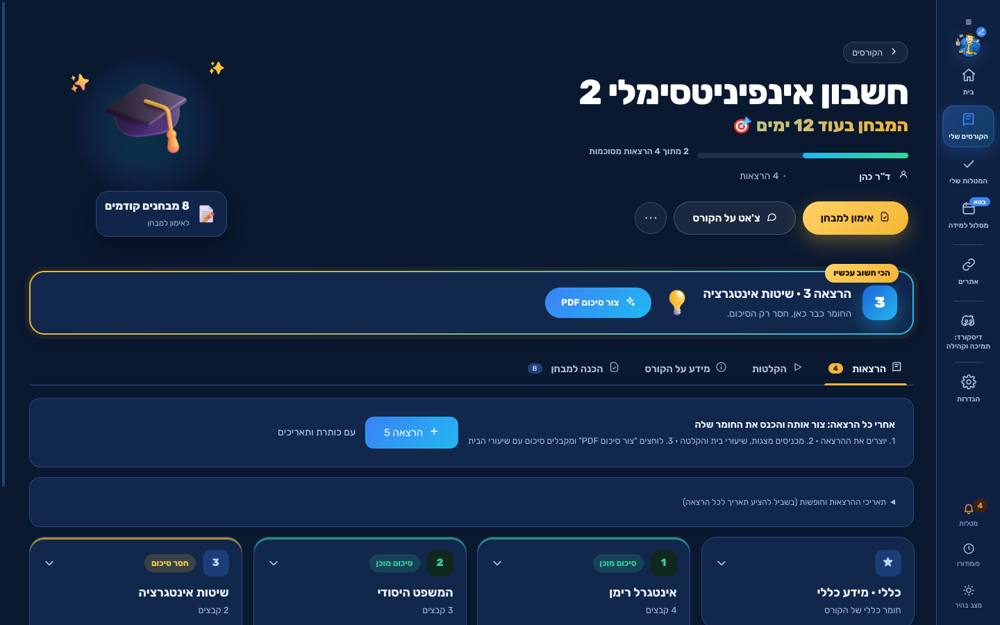
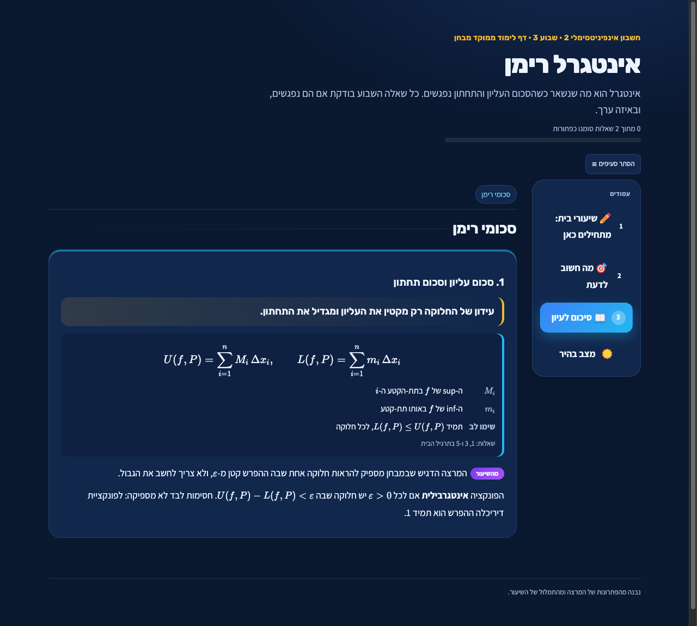

# SumIT 2.0 (macOS)

SumIT מקבל עיצוב חדש. הצבעים, הדמות ואיך שהכל עובד נשארו, אבל כל מסך עבר רענון: כותרות גדולות, שורה בצבע מדורג עם מה שהכי חשוב עכשיו, כפתורים עגולים, ופחות דברים על המסך בבת אחת.

- **מסך הבית:**
  - שורה אחת שאומרת מה הכי חשוב עכשיו, למשל המבחן הקרוב.
  - הדמות עם תוויות של הרצף והכרטיסים שמחכים לחזרה.
  - שאר החלקים (היום, מה מחכה לי, המערכת והמבחנים, הקורסים) בחלוניות שעוברים ביניהן בלשוניות או בחיצים.
- **תפריט צד צר ונקי:**
  - Moodle, הפורטל, CS24, Outlook ו-OneDrive תחת כפתור אחד, "אתרים".
  - ההדגשה גולשת לכפתור שבחרת.
- **דף הקורס:**
  - הספירה למבחן, וכמה הרצאות כבר מסוכמות.
  - "הכי חשוב עכשיו" עם ההרצאה הבאה שצריך לסכם.
  - ההרצאות ככרטיסים, כל אחד עם המצב שלו: מוכן, חסר, נכתב או בקרוב.

  
- **הסיכומים:** בכחול של SumIT, עם כרטיסים עגולים, "הרעיון החשוב" בזהב ואימוג׳ים חדשים. גם סיכומים ישנים מקבלים את המראה החדש כשהם נפתחים, והתוכן שלהם לא משתנה.

  
- **הבוחן והכרטיסים:** עיצוב רגוע יותר, ✨ כשצדקת, 💡 כשטעית, וחגיגה קטנה בסוף לפי הציון.
- **אימוג׳ים חדשים** (Fluent של Microsoft) בכל האפליקציה. הם שמורים בתוך האפליקציה ונראים אותו דבר בכל מחשב.
- **מעברים מונפשים:**
  - מסך נכנס מהכיוון של המעבר.
  - קורס נפתח כמו דפדוף קדימה.
  - לשוניות מחליקות מהצד שלהן.

  מי שהפעיל במערכת "הפחתת תנועה" מקבל את המסכים בלי אנימציה.
- **גם שאר המסכים קיבלו את העיצוב החדש:** המטלות, מסלול הלמידה, ההגדרות, הקורסים שלי, ההורדות ומסך הטעינה.
- **תיקון:** המבחן הקרוב מופיע במסך הבית מיד כשהמערכת נטענת, בלי לחכות לרענון.

נבדק: 603 בדיקות נסיגה. המסכים נבדקו במצב הדגמה, במצב כהה ובהיר.
